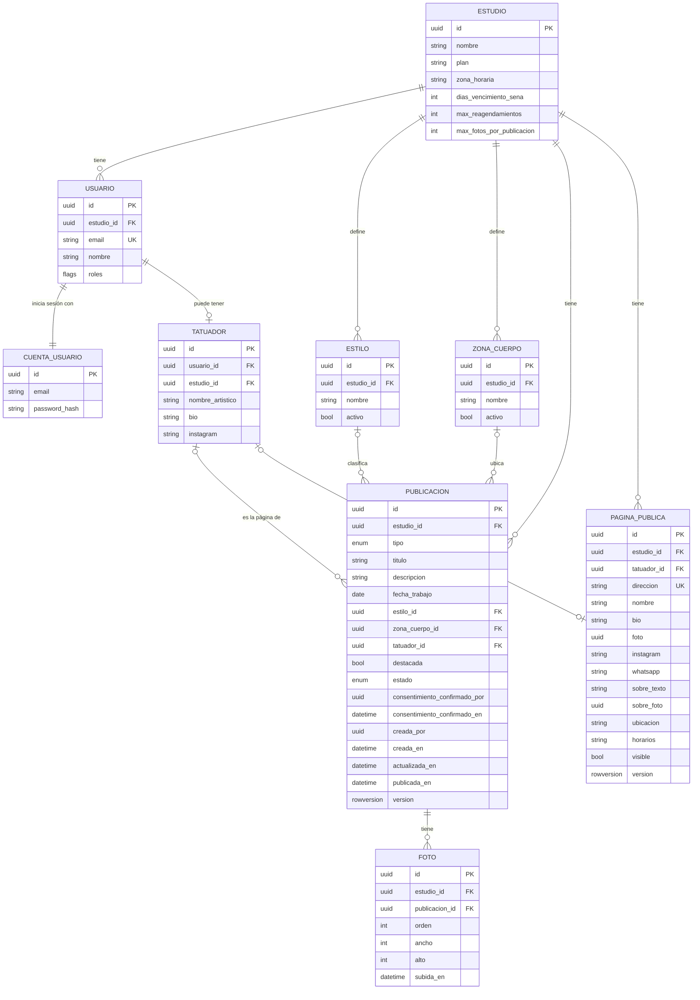
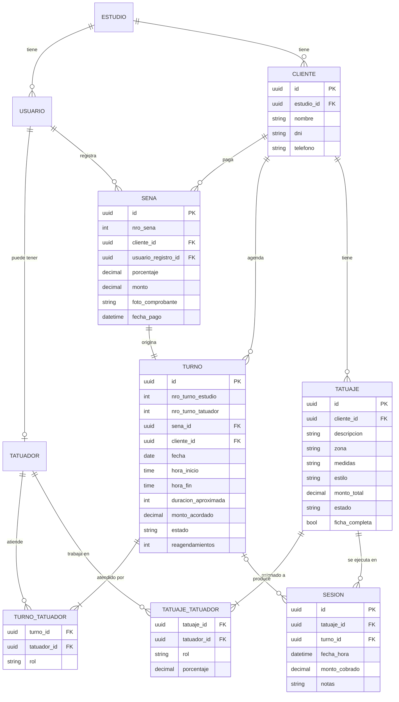

# Documento 04 · Modelo de datos

Entidades, atributos, relaciones y puntos a revisar.

| Versión | Fecha | Estado | Relacionados |
| --- | --- | --- | --- |
| 1.4 | 16 de octubre de 2026 | Versión 1 implementada · MVP en borrador, pendiente de revisión (P-01) | Docs 02, 03, 05, 06 y 07 |

> **Estado:** la parte de la versión 1 (blog y base del sistema, sección 2) refleja lo implementado en los cortes 1 y 2. La Página pública está implementada, salvo sus dos fotos (R-16). La parte del MVP (sección 3) sigue en borrador y pendiente de revisión (P-01): es un punto de partida para la discusión, no el diseño final. Las reglas de negocio de los documentos 02, 03 y 07 tienen prioridad sobre este documento.

> **Novedades de la versión 1.3:**
> - Las entidades de la versión 1, tal como quedaron implementadas: Estudio, Usuario, CuentaUsuario, Tatuador, Estilo, ZonaCuerpo, Publicación y Foto.
> - La propuesta de Página pública, y el tipo de publicación y el texto de 2200 caracteres (doc 07, versión 2.0).
> - Se resuelven R-01, R-07, R-09, R-10 y R-11, R-04 en parte, y se suman R-14 a R-16.
> - Los diagramas pasan a Mermaid, dentro del documento.

---

## 1. Principios de diseño acordados

- **Multi-tenant (D-42):** toda la información pertenece a un estudio y queda aislada de los demás. Para eso se usan EstudioId en todas las tablas del estudio, filtros con nombre de EF Core y un control al guardar que impide escribir datos de otro estudio. Row-Level Security, como segunda línea de defensa, está pendiente.
- **Identificadores:** IDs internos (UUID) generados por el dominio, separados de los números correlativos legibles (nº de seña, nº de turno del estudio, nº de turno del tatuador).
- **Sin borrados operativos:** turnos cancelados o indefinidos y tatuajes cancelados cambian de estado y quedan en el historial. Las publicaciones se ocultan (RN-BLG-06) y los valores de los catálogos se desactivan.
- **Saldos calculados:** el saldo pendiente no se almacena; se calcula en vivo.
- **Roles validados en la aplicación:** los roles son banderas del usuario (R-01), y el dominio rechaza las combinaciones no permitidas (Tatuador y Administrativo juntos, sin ser Dueño).
- **Configuración por estudio (D-34):** los parámetros de negocio son columnas del estudio, con valores por defecto (R-10).
- **Fechas en UTC (D-43):** se guardan en UTC y se muestran en la zona horaria del estudio, con Argentina por defecto.
- **Concurrencia optimista:** las entidades que editan varios usuarios llevan un token de versión (rowversion), para que un cambio no pise a otro. En un agregado, la fila raíz se actualiza en cada guardado, así la versión se controla aunque solo cambien sus hijos.
- **Agregados:** la Publicación es la raíz de sus fotos. Las fotos se agregan, se ordenan y se quitan solo a través de ella, para que sus reglas no se puedan saltear.
- **Archivos fuera de la base:** la base guarda el Id y las medidas de cada foto. Los archivos se guardan con el puerto de almacenamiento, con la clave `estudios/{estudio}/fotos/{foto}/{tamaño}.webp`.

---

## 2. Versión 1: blog y base del sistema

### 2.1 Diagrama

### 2.2 Entidades

| Entidad | Atributos | Notas | Estado |
| --- | --- | --- | --- |
| Estudio | id, nombre (hasta 100), plan (hasta 50), zona_horaria (identificador IANA, Argentina por defecto), dias_vencimiento_sena (14), max_reagendamientos (2), max_fotos_por_publicacion (10) | Tenant raíz. La configuración del estudio son columnas propias (R-10). | Implementada |
| Usuario | id, estudio_id, email (único, hasta 256), nombre (hasta 100), roles (Dueño, Tatuador y Administrativo, combinables) | Ocupa un asiento. Los roles son banderas (R-01). | Implementada |
| CuentaUsuario | id (el mismo que el del Usuario), email, hash de la contraseña, intentos fallidos y bloqueo | Tabla de ASP.NET Core Identity para iniciar sesión (R-09). El dominio no la conoce. | Implementada |
| Tatuador (perfil) | id, usuario_id, estudio_id, nombre_artistico (hasta 100), bio (hasta 1000), instagram (hasta 30) | Solo para usuarios con el rol Tatuador. | Implementada |
| Estilo y ZonaCuerpo | id, estudio_id, nombre (hasta 50, único dentro del estudio), activo | Catálogos por estudio: cada uno arranca con 13 estilos y 16 zonas, y después los adapta. No se borran: se desactivan (R-11). | Implementadas |
| Publicación | id, estudio_id, tipo (Trabajo o Blog), titulo (hasta 120), descripcion (hasta 2200), fecha_trabajo, estilo_id, zona_cuerpo_id, tatuador_id, destacada, estado (Borrador, Publicada u Oculta), consentimiento_confirmado_por, consentimiento_confirmado_en, creada_por, creada_en, actualizada_en, publicada_en, version | tatuador_id indica la página de destino; vacío, es la del estudio (RN-BLG-12). destacada es «fijada» (RN-BLG-13). publicada_en guarda la primera vez que se publicó: no cambia al ocultar y volver a publicar. | Implementada. El tipo y el texto de 2200 caracteres, por implementar (hoy el límite es 2000). |
| Foto | id, estudio_id, publicacion_id, orden (0 es la portada), ancho, alto, subida_en | Solo se cambia a través de su Publicación. El ancho y el alto son los de la versión de detalle. | Implementada |
| Página pública | id, estudio_id, tatuador_id, direccion, nombre, bio, foto, instagram, whatsapp, sobre_texto, sobre_foto, ubicacion, horarios, visible, version | Una por estudio (tatuador_id vacío) y una por artista. Detalle en la sección 2.3. | Implementada, sin foto ni sobre_foto (R-16) |

### 2.3 Página pública

| Atributo | Regla |
| --- | --- |
| tatuador_id | Vacío en la página del estudio. Cada estudio tiene una sola página propia, y cada artista una sola. |
| direccion | Única en toda la plataforma (RN-BLG-07). Minúsculas, números y guiones, de 3 a 40 caracteres. No puede ser una palabra reservada de la plataforma, como `api`, `panel` o `login`. Se arma a partir del nombre y no cambia sola si después cambia el nombre. |
| nombre | Hasta 100 caracteres. Lo elige el estudio o el artista. |
| bio | Hasta 150 caracteres, como la bio de Instagram. |
| foto | Foto o logo del encabezado (R-16). |
| instagram | Usuario sin @, hasta 30 caracteres. |
| whatsapp | Número en formato internacional, por ejemplo +5492215550000. |
| sobre_texto | Hasta 2200 caracteres. |
| sobre_foto | Opcional (R-16). |
| ubicacion, horarios | Texto libre. Solo en la página del estudio. |
| visible | La página no aparece en el sitio hasta que se habilita. |

Lo que muestra la pestaña «Sobre» se arma con estas relaciones, sin datos extra:

- **La del estudio** muestra las páginas visibles de sus artistas.
- **La de cada artista** enlaza a la página del estudio, si existe y es visible.

### 2.4 Relaciones y cardinalidades

| Relación | Cardinalidad | Nota |
| --- | --- | --- |
| Estudio — Usuario | 1 a N | |
| Usuario — CuentaUsuario | 1 a 1 | Comparten el Id. |
| Usuario — Tatuador | 1 a 0..1 | Solo con el rol Tatuador. Combinaciones de roles válidas: Dueño; Dueño + Tatuador; Dueño + Administrativo; Dueño + Tatuador + Administrativo; Tatuador; Administrativo. |
| Estudio — Estilo / ZonaCuerpo | 1 a N | |
| Estudio — Publicación | 1 a N | |
| Publicación — Foto | 1 a N | Hasta el máximo del estudio (10 por defecto). Para publicar hace falta al menos una (RN-BLG-04). |
| Tatuador — Publicación | 0..1 a N | La página de destino. |
| Estilo / ZonaCuerpo — Publicación | 0..1 a N | Opcionales. El front de la versión 1 no los usa. |
| Estudio — Página pública | 1 a N | Una del estudio y una por artista. |
| Tatuador — Página pública | 1 a 0..1 | |

---

## 3. MVP de gestión (borrador)

### 3.1 Entidades

Estudio, Usuario y Tatuador están en la sección 2.2. Dueño y Administrativo no tienen tabla propia: son roles del Usuario (R-01).

| Entidad | Atributos | Notas |
| --- | --- | --- |
| Cliente | id, estudio_id, nombre, dni, telefono | El resto de la ficha se define en P-13. |
| Seña | id, nro_sena, cliente_id, usuario_registro_id, porcentaje, monto, foto_comprobante, fecha_pago | Origina el turno (1 a 1). fecha_pago permite calcular el vencimiento según el plazo del estudio. |
| Turno | id, nro_turno_estudio, nro_turno_tatuador, sena_id, cliente_id, fecha, hora_inicio, hora_fin, duracion_aproximada, monto_acordado, estado, reagendamientos | Estados y reglas en el documento 03. |
| TurnoTatuador | turno_id, tatuador_id, rol (principal o co-tatuador) | Base del bloqueo de calendario. |
| Tatuaje | id, cliente_id, descripcion, zona, medidas, estilo, monto_total, estado, ficha_completa | Fotos de referencia: ver R-04. Zona y estilo pueden usar los catálogos de la versión 1 (R-11). |
| TatuajeTatuador | tatuaje_id, tatuador_id, rol (responsable o co-tatuador), porcentaje | Exactamente un responsable por tatuaje. |
| Sesión | id, tatuaje_id, turno_id (opcional), fecha_hora, monto_cobrado, notas | turno_id vacío = walk-in. Fotos de avance: ver R-04. |

**Entidades propuestas, todavía sin discutir**

- **Notificación** (id, usuario_id, tipo, mensaje, leída, fecha): necesaria para la campanita in-app (RN-NOT-01).
- **Fotos del MVP** (referencia del tatuaje, avance por sesión, comprobante de seña): ver R-04.
- **MensajeSaliente** (outbox) y **EventoRecibido** (webhooks ya procesados): tablas técnicas de integración (doc 06, sección 6).
- **RegistroAuditoria** (usuario_id, entidad, acción, fecha, detalle): quién hizo qué y cuándo (doc 06, sección 7.4).

### 3.2 Relaciones y cardinalidades

| Relación | Cardinalidad | Nota |
| --- | --- | --- |
| Estudio — Cliente | 1 a N | |
| Usuario — Seña | 1 a N | Quién registró la seña. |
| Cliente — Seña | 1 a N | |
| Seña — Turno | 1 a 1 | Reagendar no crea otro turno (opción A). |
| Cliente — Turno | 1 a N | |
| Turno — Tatuador | N a M (TurnoTatuador) | Un principal más co-tatuadores. |
| Cliente — Tatuaje | 1 a N | |
| Tatuaje — Tatuador | N a M (TatuajeTatuador) | Un responsable más co-tatuadores con porcentaje. |
| Tatuaje — Sesión | 1 a N | |
| Turno — Sesión | 0..1 a N | Un turno puede producir varias sesiones; una sesión sin turno es un walk-in. |

### 3.3 Diagrama

---

## 4. Puntos a revisar

| ID | Punto | Estado |
| --- | --- | --- |
| R-01 | Roles: perfiles como tablas separadas (Dueño, Tatuador, Administrativo) frente a roles por usuario más la tabla Tatuador para los datos profesionales. | Resuelto: los roles son banderas del Usuario, y solo Tatuador tiene tabla propia. |
| R-02 | cliente_id aparece en Seña y en Turno: decidir si se mantiene la redundancia o se deriva. | Abierto |
| R-03 | Los co-tatuadores viven en dos lugares: TurnoTatuador (bloqueo de agenda) y TatuajeTatuador (porcentajes). Definir cómo se sincronizan, por ejemplo cuando un co-tatuador participa solo de algunas sesiones. | Abierto |
| R-04 | Fotos como entidad propia: del blog, referencia del tatuaje, avance por sesión y comprobante de seña. | En parte: las fotos del blog son la entidad Foto, hija de la Publicación. Las del MVP siguen abiertas. |
| R-05 | ficha_completa: ¿campo guardado o calculado a partir de los campos obligatorios? | Abierto |
| R-06 | hora_fin frente a duracion_aproximada (ver P-05). | Abierto |
| R-07 | Aislamiento multi-tenant con estudio_id en todas las tablas del estudio (D-42). | Resuelto en el modelo y en el código. Falta Row-Level Security. |
| R-08 | Señas y montos en tatuajes de varias sesiones (ver P-06). | Abierto |
| R-09 | Cómo se vinculan las tablas de ASP.NET Core Identity con Usuario y los perfiles. | Resuelto: CuentaUsuario comparte el Id con el Usuario. No se usan las tablas de roles de Identity: los roles salen del Usuario. |
| R-10 | ConfiguracionEstudio: tabla 1 a 1 con Estudio o columnas dentro de Estudio. | Resuelto: columnas dentro de Estudio. |
| R-11 | Estilo y zona del cuerpo: pasar de texto libre a catálogos por estudio. | Resuelto: catálogos por estudio, con valores iniciales. |
| R-12 | Tablas técnicas (outbox, eventos recibidos, auditoría y claves de cifrado de las sesiones): ubicación y tiempo de retención. | Abierto |
| R-13 | Cifrado de las columnas con datos sensibles de clientes, según lo que se defina en P-13. | Abierto |
| R-14 | Tema visual de cada página pública (colores, tipografías, ornamentos): columnas en la Página pública o una tabla aparte. Se define con el diseño visual. | Abierto |
| R-15 | Datos repetidos entre Tatuador y Página pública (nombre artístico, bio, Instagram). Propuesta: la página guarda los suyos, y el perfil Tatuador queda para el uso interno del MVP, como el calendario. | Abierto |
| R-16 | La foto o logo y la foto de «Sobre» de cada página reutilizan el procesamiento de fotos (WebP en varios tamaños), con claves propias en el almacenamiento. | Abierto |

---

## Historial de versiones

| Versión | Fecha | Cambios |
| --- | --- | --- |
| 1.4 | 16/10/2026 | Página pública implementada (tabla PaginasPublicas), sin sus fotos (R-16). |
| 1.3 | 16/10/2026 | Entidades de la versión 1 tal como quedaron implementadas en los cortes 1 y 2. Propuesta de Página pública. Tipo de publicación y texto de 2200 caracteres (doc 07, 2.0). Se resuelven R-01, R-07, R-09, R-10 y R-11, R-04 en parte, y se suman R-14 a R-16. Diagramas en Mermaid. Pasa a Markdown, en `docs/` del repositorio. |
| 1.1 y 1.2 | 4/10/2026 | Principios de configuración por estudio, fechas en UTC (D-43) y concurrencia optimista. El aislamiento por estudio queda decidido (D-42). Entidades propuestas y puntos R-09 a R-13. |
| 1.0 | 3/10/2026 | Modelo inicial en borrador. |
